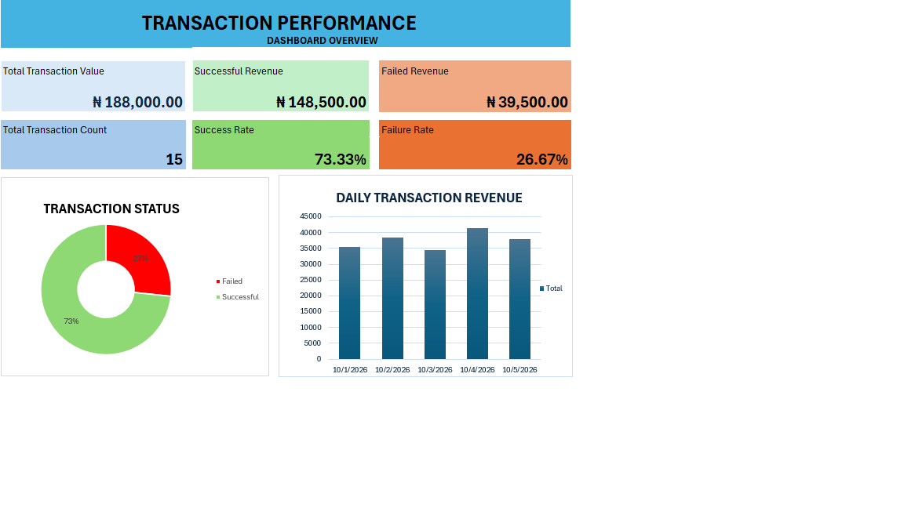

# Excel Transaction Dashboard

## Project Overview
This project uses Microsoft Excel to analyse transaction performance and daily revenue. It focuses on organising transaction records and presenting key information in a clear, easy-to-understand format.

## Project Objectives
- Track daily transaction totals.
- Analyse successful and failed transactions.
- Calculate transaction success and failure rates.
- Summarise revenue performance using key performance indicators (KPIs).
- Present findings through charts and dashboard visuals.

## Tools Used
- Microsoft Excel
- Data cleaning and filtering
- PivotTables and formulas
- Charts and KPI reporting

## Key Findings

- Total transaction value: ₦188,000
- Successful transaction revenue: ₦148,500
- Failed transaction value: ₦39,500
- Total transactions: 15
- Successful transactions: 11
- Failed transactions: 4
- Success rate: 73.33%
- Failure rate: 26.67%

## Skills Demonstrated
Data organisation, transaction analysis, Excel reporting, data visualisation and business-focused problem-solving.

## Disclaimer
This is a portfolio project. Any data used will be sample or anonymised data and will not contain confidential customer or company information.
## Dashboard Preview

